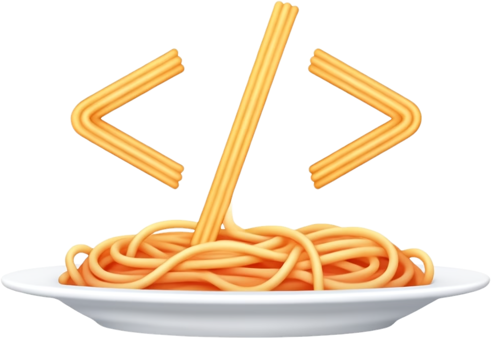
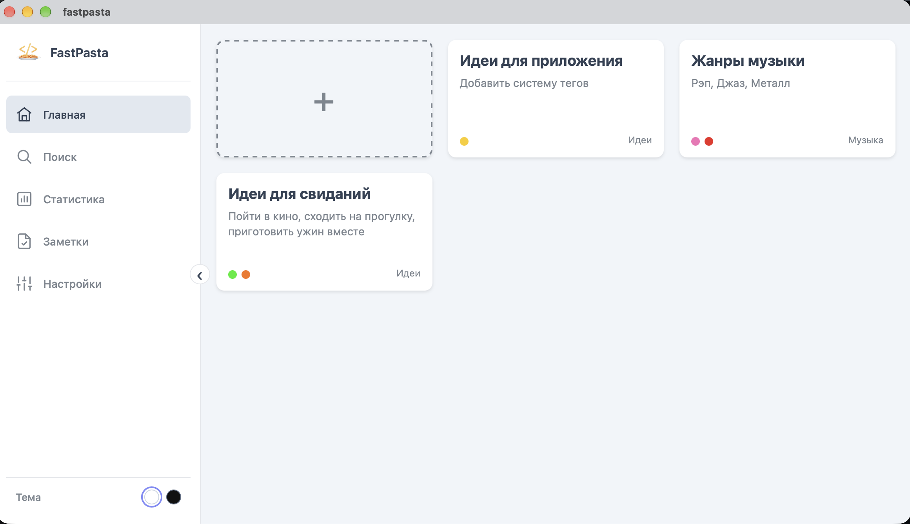
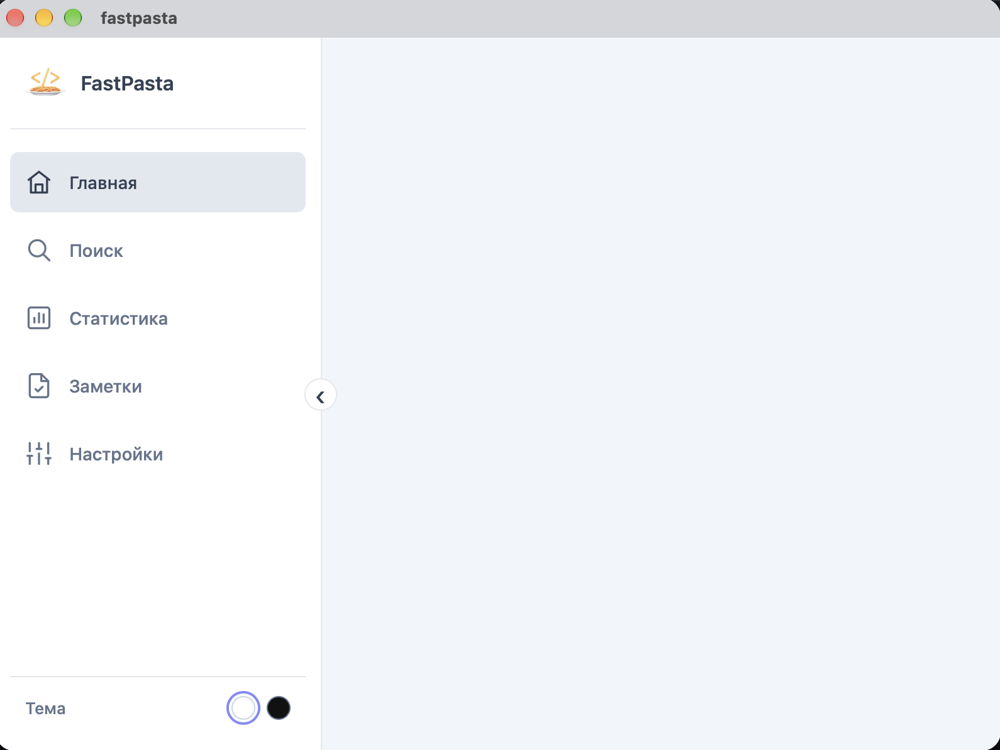

# FastPasta

  

Лёгкий менеджер для быстрой работы с заметками, сниппетами кода, идеями и задачами. 
Проект вдохновлён Obsidian, но ориентирован на быстрый доступ и простоту использования.

Функции:
- Контроль заметок (добавление, редактирование, удаление)
- Сортировка
- Быстрые фильтры
- Поиск по заметкам
- Теги, категории и даты
- Закрепление

Дополнительные функции:
- Markdown-оформление
- Избранное
- Светлая/тёмная тема

Стэк:
- HTML/CSS/JS
- Tauri

Снимки этапа разработки по настоящее время:

  
  

